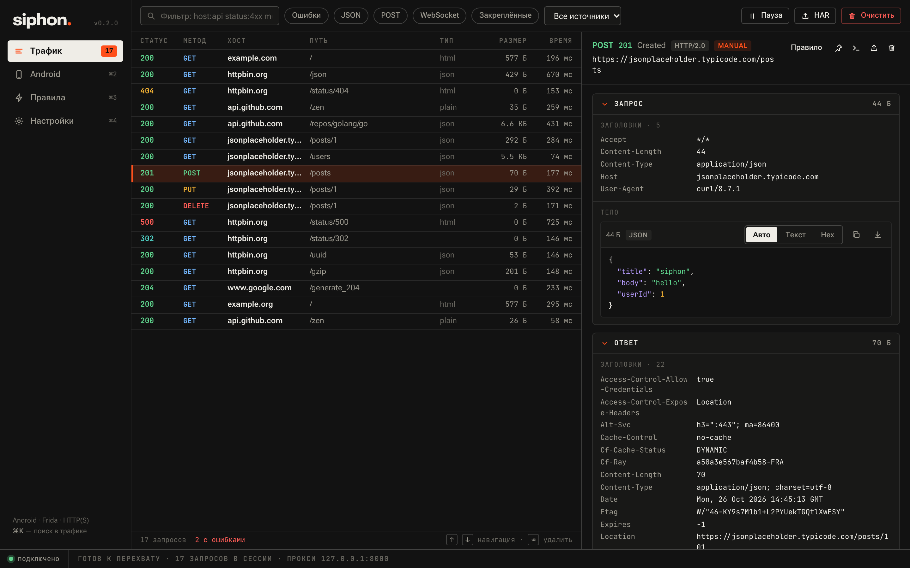

<div align="center">


# siphon.

**Инспектор HTTP(S)-трафика Android-приложений.**<br>
Выбрал приложение — увидел все его запросы в открытом виде. Без ручной установки сертификатов.

[](https://github.com/mixelka75/siphon/releases/latest)
[](https://github.com/mixelka75/siphon/actions)


**Русский** · [English](README.en.md)

<picture>
  <source media="(prefers-color-scheme: light)" srcset="docs/screenshots/traffic-light.png">
  
</picture>

</div>

## Что это

Siphon запускает на Android-устройстве [Frida](https://frida.re), направляет трафик выбранного приложения через себя
и обходит certificate pinning. Вы видите запросы и ответы, можете их менять «на лету», подменять ответы сервера
и сохранять трафик в HAR или JSON. Это нативное окно (не вкладка браузера), всё работает локально.

- **Перехват одной кнопкой** — подключили телефон или эмулятор, выбрали приложение, нажали «Перехватить».
- **Всё необходимое ставится само** — `adb` и `frida-server` Siphon скачает сам, если их нет на компьютере.
- **Правила и breakpoints** — mock, redirect, правка заголовков и тел, задержки, обрыв; пауза на запросе или ответе.
- **Любой клиент** — кроме Android, это обычный HTTP/HTTPS/SOCKS5-прокси для браузера, Postman, симулятора.
- **Умный просмотр** — JSON, формы, изображения, hex; gzip/brotli/zstd; HTTP/2, WebSocket, SSE, gRPC; экспорт HAR, JSON и cURL.
- **ИИ-агенты** — встроенный MCP-сервер: агент сам запускает эмулятор и перехват, просит вас пройти сценарий в приложении и разбирает трафик.

## Установка

Скачайте сборку на странице [**Releases**](https://github.com/mixelka75/siphon/releases/latest).

| Система | Файл | Требования |
|---|---|---|
| **macOS** 13+ (Apple Silicon и Intel) | `Siphon-macOS-universal.dmg` | — |
| **Windows** 10/11 x64 | `Siphon-Windows-x64.zip` | [WebView2 Runtime](https://developer.microsoft.com/microsoft-edge/webview2/) (в Windows 11 уже есть) |
| **Linux** x64 (Debian 12 / Ubuntu 24.04+) | `Siphon-Linux-x64.tar.gz` | `libgtk-3-0`, `libwebkit2gtk-4.1-0` |

### macOS

**Самый простой способ** — одна команда в Терминале (скачает, установит в «Программы» и сразу запустит):

```sh
curl -fsSL https://raw.githubusercontent.com/mixelka75/siphon/main/install.sh | sh
```

**Или вручную:** откройте `.dmg` и перетащите Siphon в «Программы».

Приложение не подписано платным сертификатом Apple Developer, поэтому при первом запуске macOS его остановит:

- **«Не удалось открыть, так как не удалось проверить разработчика»** — откройте **Системные настройки → Конфиденциальность и безопасность**,
  внизу нажмите **«Всё равно открыть»**. На macOS 13/14 достаточно кликнуть по приложению правой кнопкой → **Открыть**.
- **«Siphon повреждён и не может быть открыт»** — это тот же карантин, не повреждение файла. Снимите его командой:

  ```sh
  xattr -dr com.apple.quarantine /Applications/Siphon.app
  ```

Делается один раз, дальше приложение запускается как обычное.

### Windows

Распакуйте архив и запустите `Siphon.exe`. Если SmartScreen пишет «Windows защитила ваш компьютер» —
**Подробнее → Выполнить в любом случае** (сборка не подписана).
Для физического телефона нужен драйвер USB вашего производителя (для Google Pixel — [Google USB Driver](https://developer.android.com/studio/run/win-usb)); эмулятору драйвер не нужен.

### Linux

```sh
sudo apt install libgtk-3-0 libwebkit2gtk-4.1-0     # зависимости
tar xzf Siphon-Linux-x64.tar.gz && cd Siphon-Linux-x64 && ./install.sh
```

Скрипт ставит Siphon в `~/.local` (без sudo) и добавляет значок в меню приложений. Или та же однострочная команда, что для macOS.

## Быстрый старт

1. Запустите эмулятор или подключите телефон по USB с включённой «Отладкой по USB».
2. Откройте **Android → Подготовить устройство**. Если на компьютере нет `adb`, Siphon предложит скачать
   официальные platform-tools от Google (≈15 МБ) — нажмите «Скачать».
3. Выберите приложение и нажмите **Перехватить**. «Перезапустить» подключает хуки с самого старта приложения.
4. Перейдите в **Трафик**. Запросы появятся сами.

> **Нужен root.** Подойдёт образ эмулятора **Google APIs** (без Google Play) или телефон с root/Magisk.
> Сертификат на телефон вручную ставить не нужно.

## ИИ-агенты

Siphon — MCP-сервер для Claude Code, Cursor, Codex и других агентов. Подключение для Claude Code (macOS):

```sh
claude mcp add --scope user siphon -- /Applications/Siphon.app/Contents/MacOS/Siphon mcp
```

Дальше достаточно попросить: «Подними эмулятор, перехвати `com.example.shop`, я войду в аккаунт — потом опиши API
и напиши клиент». Агент запустит эмулятор, подготовит устройство и включит перехват. Затем покажет в окне Siphon
баннер с просьбой и будет ждать, пока вы нажмёте «Готово». После этого он прочитает расшифрованный трафик.
Команда для вашей системы — в **Настройки → ИИ-агенты**, подробности и HTTP API для агентов без MCP — в [docs/AI.md](docs/AI.md).

## Горячие клавиши и фильтры

| | |
|---|---|
| `⌘1`…`⌘4` / `Ctrl+1`…`4` | разделы: Трафик, Android, Правила, Настройки |
| `⌘K` / `Ctrl+K` | поиск по трафику |
| `↑` `↓`, `Delete` | навигация и удаление запроса |

Фильтр: `host:api status:4xx method:post type:json src:com.app is:error -слово`

## Если что-то не работает

| Симптом | Что делать |
|---|---|
| Устройство не видно | Включите «Отладку по USB», подтвердите ключ на телефоне; на Windows поставьте USB-драйвер; на Linux добавьте [udev-правила](https://developer.android.com/studio/run/device#setting-up) |
| «Нужен root» | Используйте эмулятор Google APIs (без Play Store) или телефон с Magisk |
| Приложение вылетает при перехвате | Включите **«Совместимый TLS»** в карточке перехвата |
| Эмулятор завис после Frida | Кнопка **«Восстановить Android»** на странице Android |
| Часть запросов — «TLS passthrough» | Приложение закрепило сертификат; это не расшифрованный запрос. Попробуйте режим «Перезапустить» |

Подробнее про перехват, профиль 2ГИС и восстановление Frida — в [docs/ANDROID.md](docs/ANDROID.md).

## Сборка из исходников

Нужны Go 1.27.3+ и Node 22+. Для нативных сборок: на macOS — Xcode Command Line Tools,
на Linux — GCC, pkg-config, GTK 3 и WebKitGTK 4.1 (`-dev`). Wails закреплён на 2.17.0.

```sh
make setup             # npm-зависимости интерфейса
make test              # vet, Go race-тесты, TypeScript
make native            # нативное приложение для текущей ОС
make native-windows    # Siphon.exe
make native-linux      # Docker → bin/linux-amd64/siphon
make build             # bin/siphon: режим в браузере (127.0.0.1:8484)
```

**Релизы собирает GitHub Actions.** Достаточно поставить тег:

```sh
git tag v0.3.0 && git push origin v0.3.0
```

Пайплайн соберёт macOS (universal, ad-hoc подпись, `.dmg` и `.zip`), Windows и Linux, посчитает `SHA256SUMS.txt`
и опубликует релиз. Каждый push в `main` тоже собирает все три платформы (артефакты во вкладке Actions).

## Границы версии

- Интерфейс в системном WebView (React), а не отдельная реализация на SwiftUI/WinUI/GTK.
- iOS, редактор произвольных запросов (resend) и генерация кода пока нет.
- Внешний upstream-прокси не применяется к WebSocket и raw TCP.
- Ни одна версия Frida не гарантирует обход pinning у любого приложения.
- Бинарники не подписаны сертификатами Apple/Microsoft. macOS-сборка имеет локальную ad-hoc подпись.

Данные: macOS `~/Library/Application Support/Siphon`, Linux `~/.config/Siphon`, Windows `%AppData%\Siphon`
(можно переопределить `SIPHON_DATA_DIR`). Завершённый трафик хранится в памяти — для сохранения экспортируйте HAR или JSON.

## Устройство репозитория и лицензии

`cmd/siphon` — CLI · `desktop` — нативное окно · `internal/proxy`, `rules`, `capture` — трафик ·
`internal/adb`, `frida`, `intercept`, `fridascripts` — Android · `internal/api` — локальный API · `ui` — интерфейс.

В `internal/fridascripts/scripts` включены скрипты [HTTP Toolkit](https://github.com/httptoolkit/frida-interception-and-unpinning)
(AGPL-3.0-or-later), их LICENSE и сведения об источнике. `native-openssl-trust.js` — скрипт Siphon.
